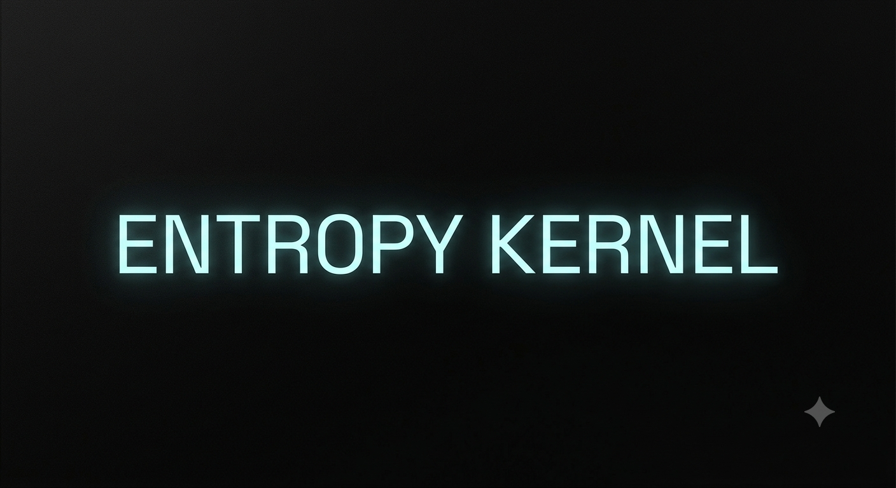

  

# Entropy v1.7

* **Совместимость:** AOSP
* **Версия ядра Linux:** 4.19.x
* **Поддержка:** KSU / KSU-SUSFS / Non-KSU
* **Дата билда:** 07.10.2026

---

<b>  Список изменений </b>

 

* Базируется на ядре qcom/sm8250 от LineageOS.
* Повторно исправлена работа аналогового аудио.
* Обновлены KSU (BakaSU) и SUSFS до версии 2.3.0.

<b> Скачать</b>

 

* [KSU](https://sourceforge.net/projects/bitra-archive/files/Kernels/Entropy/v1.7_07.10.2026/Entropy-1.7_KSU-20261007-0456.zip/download)
* [KSU SUSFS](https://sourceforge.net/projects/bitra-archive/files/Kernels/Entropy/v1.7_07.10.2026/Entropy-1.7_KSU_SUSFS-20261007-0522.zip/download)
* [Non-KSU](https://sourceforge.net/projects/bitra-archive/files/Kernels/Entropy/v1.7_07.10.2026/Entropy-1.7-20261007-0447.zip/download)

* [**Менеджер**](https://sourceforge.net/projects/bitra-archive/files/Kernels/Entropy/v1.7_07.10.2026/BakaSU_v4.2.0-rc3_35217-arm64-v8a-release.apk/download)

